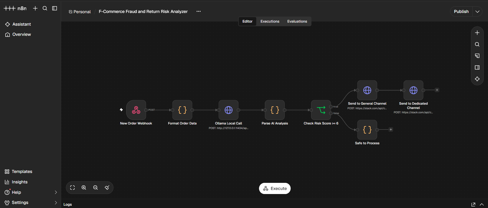
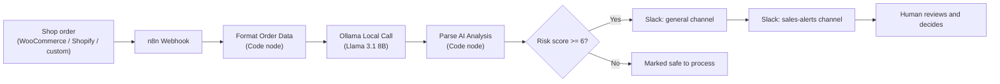

# COD Fraud Risk Analyzer

**Flags risky Cash-on-Delivery orders before they ship, so a human can verify them first. Runs on a $0 local AI stack.**

## Demo

[](https://youtu.be/F6umwGMi7EU)

▶️ [Watch the full demo on YouTube](https://youtu.be/F6umwGMi7EU) (all data shown is synthetic test data)



## Problem

In Bangladesh, many Cash-on-Delivery (COD) orders are returned undelivered because of fake orders, wrong phone numbers, or incomplete addresses. Each return costs the seller courier fees and time.

## Who it's for

Small and medium F-commerce / e-commerce sellers in Bangladesh who ship COD orders and want to check risky orders before sending them.

## Solution overview

Each new order is scored for return/fraud risk by a local AI model (Llama 3.1 8B via Ollama). If the score is 6 or higher, the sales and support team gets Slack alerts with the reasons and a recommended action. Lower-risk orders are marked safe to process.



## Tech stack ($0 software cost)

| Layer | Tool |
|---|---|
| Automation | n8n Community Edition (self-hosted, localhost:5678) |
| AI model | Ollama running `llama3.1:8b` (local) |
| Scripting | JavaScript (n8n Code nodes) |
| Alerts | Slack Web API (`chat.postMessage`) via HTTP Request node |
| Testing | Windows PowerShell / cURL |

Tested on consumer hardware: Ryzen 5 CPU, 16 GB RAM.

## How it works

1. An order (name, phone, address, amount, payment method) arrives at an n8n **Webhook** via POST.
2. A **Code node** cleans the data and fills missing fields with defaults.
3. **Ollama** (Llama 3.1 8B, JSON output mode) scores the order from 0 to 10 using Bangladesh-specific rules:
   - Valid 11-digit mobile number (013-019)
   - Address has house/road/area, not just a city or district
   - High-value COD order with a vague address raises the risk
4. A **Code node** parses the AI's JSON output.
5. An **IF node** checks `risk_score >= 6`.
6. High risk: alerts go to two Slack channels one after another (`#general` summary, then `#sales-alerts` action message).
7. Low risk: the order is marked as safe to process.

Example AI output:

```json
{
  "risk_score": 8,
  "risk_level": "HIGH",
  "reasons": ["Invalid phone number format", "Vague address"],
  "recommended_action": "Call customer to verify before shipping"
}
```

## Human-in-the-loop / safety design

- The AI **only recommends**. It never cancels or blocks an order on its own.
- Staff review every high-risk alert and decide: call the customer, ship, or cancel.
- AI analysis runs locally; order details are not sent to a cloud AI service.
- Only synthetic data is used in this repo. No real customer data is included.

## Results

| Metric | Before | After | How measured | Data type |
|---|---|---|---|---|
| End-to-end workflow run | n/a | 1 run completed; high-risk branch triggered and Slack alerts delivered | Manual test, shown in the demo video | Synthetic |
| Risk-scoring accuracy | n/a | Not yet measured | Planned: 30-50 labeled sample orders | n/a |
| Reduction in returns / courier loss | n/a | Not yet measured | Needs a real pilot with a seller | n/a |
| Software running cost | n/a | $0/month (open-source tools, local hardware) | By design | n/a |

> These results show the system **works end to end**. They do **not** yet prove how accurate the AI is or how much money it saves.

## Limitations & risks

- Tested with a single synthetic order. Accuracy and real-world return reduction are unproven.
- An 8B local model can make mistakes: some good orders may be flagged and some risky ones missed.
- Phone and address checks are done by the LLM, so results may vary. Fixed code rules (regex) would be more consistent.
- Slack alerts contain order details. Phone numbers are not masked yet.
- No customer history or courier return data is used yet.
- This tool assists human decisions. It is not a guarantee of fraud detection.

## Setup

1. Install [n8n](https://docs.n8n.io/hosting/) and run it locally.
2. Install [Ollama](https://ollama.com) and download the model:
   ```
   ollama pull llama3.1:8b
   ```
3. In n8n, import the workflow JSON from the `workflows/` folder.
4. Create a Slack app, give the bot token the `chat:write` and `chat:write.public` scopes, and add the token in n8n credentials (never in the workflow file). See `.env.example` for the values used.
5. Activate the workflow and send a test order to the webhook URL. Sample orders are in `data/sample-orders.json`.

## Lessons learned

- Strict JSON output from the model makes the rest of the automation reliable.
- A test run proves the workflow works, but not that the AI is accurate. Accuracy needs a labeled test set.
- Rules that must always be exact (like phone format) belong in code, not in an LLM prompt.

## What's next

- Move phone/address checks into code rules
- Evaluate on 30-50 labeled synthetic orders and publish accuracy
- Mask phone numbers in Slack alerts
- Add order-history checks

## License & contact

MIT License (add a `LICENSE` file via GitHub: Add file → Create new file → name it `LICENSE` and choose a template, if offered).

Contact: ferdoushasanmaruf16@gmail.com 
